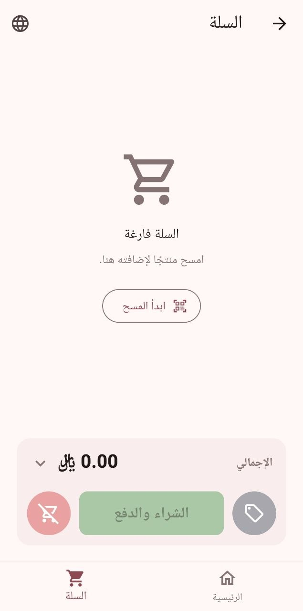
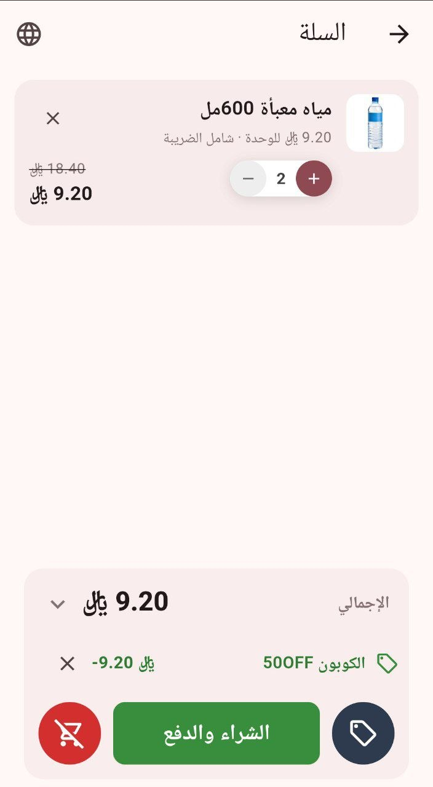
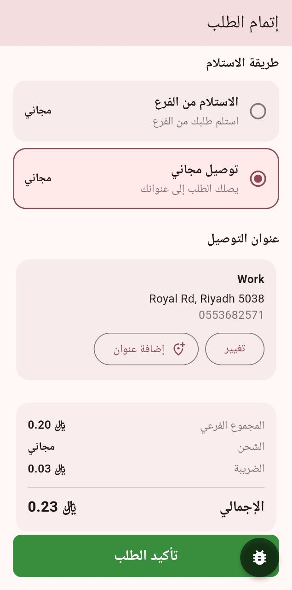
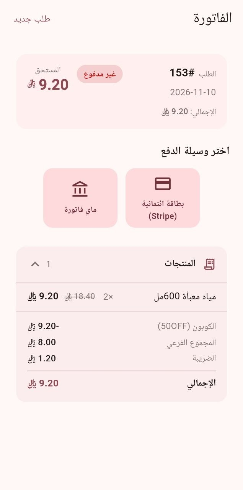

# Waha Client

Customer app for Waha, a multi-store retail system. It runs on the customer's own
phone, tablet or browser and consumes the [Waha backend](https://github.com/MohammadMousa/waha) REST API.

The Waha apps are separate projects:

| Project | What it is |
|---|---|
| **waha_client** (this repo) | Customer app: **normal** (online ordering) and **shopping** (in-store self-service) modes |
| **waha_admin** | Dashboard / admin app |
| **waha_platform** | Kiosk app (self-service terminals) |

---

## Stack

- **Flutter / Dart** — Android, iOS, Web
- **Provider** — state management
- `flutter_localizations` + ARB — full Arabic / English localisation, RTL-aware
- `shared_preferences` — token, store and mode persistence across restarts
- `webview_flutter` — HTML landing pages
- `mobile_scanner` — camera barcode / QR scanning

## Running locally

```bash
# Android emulator
flutter run --dart-define=API_BASE_URL=http://10.0.2.2:8080

# iOS simulator or desktop
flutter run --dart-define=API_BASE_URL=http://localhost:8080

# Physical device on LAN
flutter run --dart-define=API_BASE_URL=http://192.168.1.x:8080

# Web
flutter run -d chrome --dart-define=API_BASE_URL=http://localhost:8080
```

## Building for an environment

The server address is not in the code — it is baked in at build time from a
per-environment settings file in `config/` (git-ignored; only the
`*.example.json` templates are committed).

```bash
cp config/prod.example.json config/prod.json   # then fill in the real values
scripts/build_release.sh prod                  # bumps version, builds the APK
flutter run --dart-define-from-file=config/dev.json   # same file works for runs
```

`API_BASE_URL` is the app's default server. On the device, Settings → Server
Connection → **Custom Connection** overrides it (ON) and returning to it (OFF)
never loses the saved custom fields. A plain `flutter run` with no settings
file falls back to the emulator/localhost address, never to production.

---

## Modes

The app has two operating modes.

| Mode | Who uses it | Behaviour |
|------|-------------|-----------|
| **Normal** | Customer ordering online | Works like any ordering app: browse, search, product detail, cart, then a **checkout screen** (delivery or pickup, address, shipping), pay, e-invoice |
| **Shopping** | Customer already inside the store | Self-service, like a kiosk: scan items, the **cart is the working screen**, coupons are entered in the cart, and **"Buy & Pay" creates the order right there** — no checkout screen, no addresses, no shipping. Navigation is restricted to the shopping flow |

Shopping mode can also run on device accounts.
Coupons are entered in the cart screen in both modes.

### Sessions

- **Normal mode:** there is no guest account. With no auth token the app is an *anonymous* session: the customer can browse and add to a local cart (in memory — lost if the app closes). A server-side cart is not built yet (planned). Tapping checkout while anonymous redirects to login.
- **Shopping mode:** the app logs in automatically with a stored token (from a previous guest session or a regular account). With no token, or an invalid one, a new guest session is created in the background.
- **Store:** the app never opens without a store in the session. A regular user account has no store (unlike a device account), so after login the app assigns the saved default store; if there is none it opens the store picker. Only then does the customer reach the landing page.

### Flow

- **Normal:** Landing → Login → Store → Browse → Product detail → Cart → Checkout → Pay → E-invoice
- **Shopping:** Landing → (first scan) Cart → Buy & Pay → Pay → E-invoice

---

## Key features

### Catalog & shopping
- **Browse / Search / Categories** — product grid, category filter, full-text search
- **Product detail sheet** — gallery, description, tags, add to cart
- **Cart** — quantity stepper per product, live server-computed quote, unit prices labelled *inc VAT* / *exc VAT* from the organization's setting
- **Coupons** — entered in the cart (type the code or scan it with the camera); the server validates it on every quote, and the discount shows in the totals and on the invoice
- **Barcode scan** — camera scan or hardware scanner (keyboard wedge). In shopping mode the first scan switches to the cart

### Payment & invoice
- **Simulated**, **QR**, **redirect** (Stripe / MyFatoorah) and **terminal** payment, depending on the store's payment methods
- **Invoice screen** — live payment status, discount and coupon rows, PDF download

### Landing pages
- HTML pages from the store's resources rendered in a WebView; language toggled without reload
- Banner links (`/screen?name=browse_screen&tag=TAG`) navigate inside the app, also in shopping mode

---

## Project structure

```
lib/
├── config/       API base URL and app settings (dart-define overrides)
├── l10n/         app_en.arb, app_ar.arb, generated/ (flutter gen-l10n output — do not edit)
├── models/       cart item, order, quote (with coupon), product, store, payment method …
├── router/       app_router.dart — named routes and the shopping-mode route guard
├── screens/      landing, browse, categories, search, product detail, scan, camera scan,
│                 cart, checkout, pay, invoice, success, orders, login, register,
│                 store picker, sessions, settings, server connection
├── services/     api_client.dart (all HTTP calls), api_exceptions, local_prefs,
│                 hardware_scanner_service, scan_sound_service, landing_cache …
├── state/        auth_service, browsing_mode_service, order_flow_controller (cart, quote,
│                 coupon, order), store_config_service, locale_service, permission_service …
├── utils/        money formatting, scan actions, locale helpers
└── widgets/      cart line tile, product image, quantity stepper, bottom nav,
                  hardware scan listener, profile sheet …
```

---

## Localization

ARB files live in `lib/l10n/`. After editing, regenerate:

```bash
flutter gen-l10n
```

Generated files go to `lib/l10n/generated/` — do not edit by hand. The active locale is managed by `LocaleService` and can be toggled at runtime (the cart shows a language button in the app bar).

---

## Product images

`ProductImage` widget handles all product, category, and store avatar display:
- Shows a two-ring loading spinner while the image loads
- Falls back to a tinted placeholder on error or when `imageResourceId` is null
- URL is `{API_BASE_URL}/api/resources/{imageResourceId}` — served directly from the backend

Gallery images in the product detail sheet are loaded as a horizontal strip via the same widget.

---

## Screenshots

The customer app, in Arabic. All screens belong to waha_client; the dashboard and the kiosk have their own repositories.

| Shopping mode: empty cart | Shopping mode: cart with a coupon |
|---|---|
|  |  |

| Normal mode: checkout with delivery | Invoice with the coupon discount |
|---|---|
|  |  |
